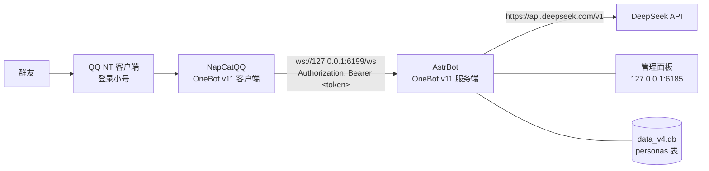

# DeepSeek QQ 机器人

把 DeepSeek 接进 QQ 群，让它像群里一个活人那样说话——有身份、有脾气、认得人、会自己接话。

Windows 上双击几个 bat 就能跑起来，不用写代码、不用配 Python 环境、不用碰服务器。

[](LICENSE)


> **先用小号。** 本项目通过非官方协议接入 QQ，主号有被限制或封禁的风险，这个风险只能你自己承担。
>
> **本仓库不含任何第三方二进制。** QQ 客户端、NapCat、AstrBot 都由你自己从官方渠道获取，仓库里只有脚本、配置模板、人设工作流和文档。

---

## 它是什么

QQ 机器人这件事，从来不是"调个 API"那么简单：你得有一个能收发 QQ 消息的协议端、一个会调度消息和插件的机器人框架、一个足够聪明还能装得像人的模型，然后把三者接起来、把配置写对、把人设塞进正确的位置。

本项目做的事就是把这三段接好，并且把踩过的坑固化成脚本：

| 层 | 选型 | 在本项目里的角色 |
|---|---|---|
| QQ 协议端 | [NapCatQQ](https://github.com/NapNeko/NapCatQQ) | 登录你的 QQ 小号，用 OneBot v11 反向 WebSocket 把消息推给 AstrBot |
| 机器人框架 | [AstrBot](https://github.com/AstrBotDevs/AstrBot) 4.29.1 便携版 | 消息路由、会话上下文、插件系统、管理面板 |
| 模型 | [DeepSeek](https://platform.deepseek.com) `deepseek-chat` | 真正说话的那个"大脑" |
| 人设 | 一份 Markdown | 写进 AstrBot 的 `personas` 表，作为 system prompt |
| 本仓库 | PowerShell + bat + 模板 | 下载依赖、写配置、灌人设、收诊断日志 |

## 能干什么

| 能力 | 状态 | 说明 |
|---|---|---|
| 群里 @ 它，按人设回复 | ✅ 默认开启 | 必须是 QQ 真提及，手打 `@名字` 不算，见[常见问题](docs/常见问题.md) |
| 私聊 | ✅ 默认开启 | 与群聊上下文独立 |
| 认出是谁在说话 | ✅ 推荐开启 | 面板里把 `identifier` 打开，能拿到昵称并注入上下文 |
| 群聊上下文记忆 | ✅ 推荐开启 | 只覆盖群聊，私聊不在内；上限可调到 700 条 |
| 主动插话 | ⚙️ 需开启 | 面板里 `active_reply`，概率建议 0.2，太高会像刷屏机器人 |
| 分段回复（像真人一样一条条发） | ⚙️ 需开启 | 间隔 1.5–3.5 秒最自然 |
| 长期记忆 | ⚙️ 需装插件 | 见[路线图](#路线图) |
| 世界书 / 关键词追加设定 | ⚙️ 需装插件 | 见 [docs/世界书.md](docs/世界书.md) |
| 发 QQ 空间说说 | ⛔ 不推荐 | 非标准接口，风控最重 |

## 架构



| 端口 | 谁在听 | 用途 |
|---|---|---|
| `6185` | AstrBot | 管理面板（用户名 `astrbot`） |
| `6199` | AstrBot | OneBot v11 反向 WebSocket，路径 `/ws` |
| `3000` / `3001` | NapCat | HTTP / SSE（正向连接时用，反向连接可不用） |

具体到"配置文件的哪一行在起作用"，见 [docs/架构与原理.md](docs/架构与原理.md)。

## 快速开始

需要：Windows 10/11、一个能登录的 QQ 小号、一个 DeepSeek API Key（充几块钱够用很久）。

```powershell
git clone https://github.com/<你的用户名>/deepseek-qq-bot.git
cd deepseek-qq-bot
```

**第 1 步｜装 QQ**
去 [im.qq.com](https://im.qq.com) 装官方 **NT 版**，登录小号。别用精简版或第三方修改版，NapCat 只认官方 NT 版。

**第 2 步｜下载依赖**
双击 `installer\下载依赖.bat`。它会把 AstrBot 便携包（约 173 MB，带内置 Python）和 NapCat 下载解压到位。

> 卡住不动基本是 GitHub 连不上：先开代理，确认混合端口是 7890 再重跑；端口不是 7890 就编辑这个 bat，给最后一行加 `-ProxyUrl "http://127.0.0.1:你的端口"`。

**第 3 步｜先跑一次，让它生成配置**
双击 `3_一键启动.bat`，等到出现 `http://127.0.0.1:6185` 就可以关掉了。**这步不能跳**——向导要依赖它生成的 `data\cmd_config.json` 和 SQLite 库。

**第 4 步｜填 API Key**
双击 `2_配置向导.bat`，粘 Key。它会顺手校验一次（200 正常 / 401 Key 错 / 402 余额不足），然后写出 OneBot 平台、DeepSeek 模型来源和模型条目，并把 `preset\persona\_我的设定.md`（存在的话）灌进数据库。

**结尾会打印两个值，下一步要用：**

```
反向 WebSocket 地址: ws://127.0.0.1:6199/ws
Access Token:        astrbot-xxxxxxxxxxxxxxxxxxxxxxxx
```

**第 5 步｜把 NapCat 接上来**
启动 NapCat，首次用手机扫码登录小号，然后新建一个 **WebSocket 客户端（反向）**：

| 项 | 填什么 |
|---|---|
| 地址 | `ws://127.0.0.1:6199/ws` |
| Token | 第 4 步打印的那串 |
| 消息格式 | `array` |

如果你用的已经是 NapCatQQ Desktop 之类的管理器，在实例的「网络配置」里填同样两条即可，不必再装一套。

**第 6 步｜试一句**
在群里真 @ 它，说句话。1–3 秒内有回复就通了。不行看 [常见问题](docs/常见问题.md)。

**可选｜给它一个角色**
默认它是个没有性格的通用助手。想要人设：照着 [`preset/persona/`](preset/persona/README.md) 里的卡片填，
另存为 `preset\persona\_我的设定.md`，重跑一次向导；方法论与温度实测见 [docs/人设指南.md](docs/人设指南.md)。

## 目录结构

```
deepseek-qq-bot/
├─ 1_先读我.txt            首次使用前的 60 秒速览
├─ 2_配置向导.bat          写配置 + 灌人设 + 打印 token
├─ 3_一键启动.bat          拉起 NapCat 与 AstrBot
├─ installer/
│  └─ 下载依赖.bat         下载 AstrBot 便携版与 NapCat（含代理探测与体积校验）
├─ lib/
│  ├─ wizard.ps1           向导实现
│  ├─ start.ps1            启动器实现
│  ├─ fetch.ps1            下载与解压、版本固定与校验
│  ├─ collectlogs.ps1      收集诊断（自动给 Key / token 打码）
│  ├─ set_persona.py       把人设写进 data_v4.db 的 personas 表
│  ├─ persona_qa.py        人设压力测试：20 条探针 + 露馅词检测
│  └─ pack.ps1             打成可分发的 zip
├─ preset/
│  ├─ astrbot/             平台、模型来源、模型条目三份 JSON 模板
│  ├─ persona/             填法说明、空白卡、完整模板、示例人设（林小满）
│  └─ worldbook/           世界书格式说明与示例 yaml
├─ 诊断/
│  └─ 收集日志.bat         生成脱敏诊断 zip
├─ app/                    解压后的 AstrBot（git 忽略）
├─ napcat/                 NapCat（git 忽略）
└─ docs/                   全部文档
```

## 它为什么不像 AI

三件事决定了"像不像人"：人设质量、采样温度、以及人设到底写到了哪里。

1. **人设要具体。** 写"她很温柔"没用，写"嘴上骂你，转头把伞塞给你"才有用。完整方法见[人设指南](docs/人设指南.md)。
2. **温度别贪高。** DeepSeek 官方推荐通用对话用 1.3，但同一套人设在 1.3 下 20 条探针崩 4 条（夹英文、人称错乱、整段废句），1.0 是 0 崩。实测数据在 [docs/dev-notes/03-真链路与温度实测.md](docs/dev-notes/03-真链路与温度实测.md)。
3. **人设必须进 system prompt。** 塞进 `prompt_prefix` 是错的——那是拼在用户消息上的，模型自带的"乐于助人的助手"口吻依然生效，AI 味会从缝里漏出来。本项目的 `set_persona.py` 直接写 `personas` 表，原因见 [docs/架构与原理.md](docs/架构与原理.md#为什么人设不能放-prompt_prefix)。

## 常踩的坑

完整版见 [docs/常见问题.md](docs/常见问题.md)，这里是最容易撞上的六个：

| 现象 | 根因 |
|---|---|
| 日志报「未找到任何可用的对话模型」 | 只写了 `provider_sources`（API + Key），没写 `provider`（具体模型条目），两者是两回事 |
| 群里 @ 它没反应 | 手打的 `@` 不算唤醒，必须是 QQ 真提及或 `/` 开头 |
| NapCat 注入失败 | 管理器把 `D:\QQ` 和 `Versions\...` 拼成了 `D:\QQVersions\...`（少反斜杠） |
| 启动卡住不下发端口 | `data\dist` 缺失时 AstrBot 会尝试联网下载面板，把便携包的 `webui\` 复制成 `data\dist` |
| 回着回着开始说胡话 | 温度 1.3 对该人设过高，改成 1.0 |
| 某天 QQ 更新后失效 | QQ 自动更新会废掉 NapCat 注入，禁用更新或重装 NapCat |

## 路线图

- [ ] 「读空气」：用 [astrbot_plugin_group_chat_plus](https://github.com/Him666233/astrbot_plugin_group_chat_plus) 决定要不要接话，而不是固定概率
- [ ] 长期记忆插件选型（`astrbot_plugin_memory` / `astrbot_plugin_memory_beyond`）
- [ ] 世界书与角色卡（SillyTavern 格式）互转
- [ ] 一键切换到云端部署的 compose 模板
- [ ] 把向导做成 GUI（现在是黑窗口）

## 参与与反馈

- 遇到问题先跑 `诊断\收集日志.bat`，生成的 zip 里 API Key 与 token 已自动打码，可以安全贴到 Issue 里。
- 提 Issue 请带上：诊断 zip、NapCat / AstrBot 版本、Windows 版本。
- PR 欢迎，尤其是文档纠错和新的失败案例（这类项目最值钱的就是"踩过什么坑"）。

## 第三方与许可证

本项目自身的脚本与文档使用 **MIT**（见 [LICENSE](LICENSE)）。它调用的第三方组件各有各的许可证，**不分发、不内置**：

| 组件 | 许可证 | 本项目怎么处理 |
|---|---|---|
| AstrBot / AstrBot-desktop | AGPL-3.0 | 由 `installer` 运行时下载官方 release，仓库不含其二进制；未修改其源码 |
| NapCatQQ | NOASSERTION（权利状态不明确） | 同样由使用者在本地下载，仓库与分发包都不内置 |
| QQ 客户端 | 专有 | 只从腾讯官网获取 |
| 插件（worldbook / memory / qzone 等） | 各自许可证 | 由使用者在面板插件市场自行安装 |

完整声明见 [THIRD-PARTY-NOTICES.md](THIRD-PARTY-NOTICES.md)。

## 免责声明

本项目使用非官方协议接入 QQ，可能违反腾讯的服务条款，存在账号被限制、冻结或封禁的风险。请务必使用小号，并自行评估风险。

因使用本项目产生的任何账号、数据、法律或其他后果，由使用者自行承担；作者不对任何损失负责。请勿将本项目用于骚扰、诈骗、冒充真人等用途。
